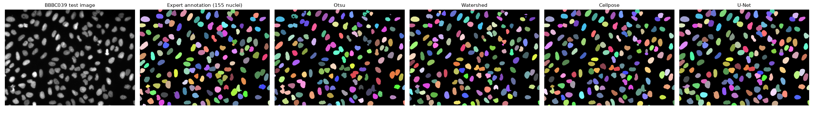
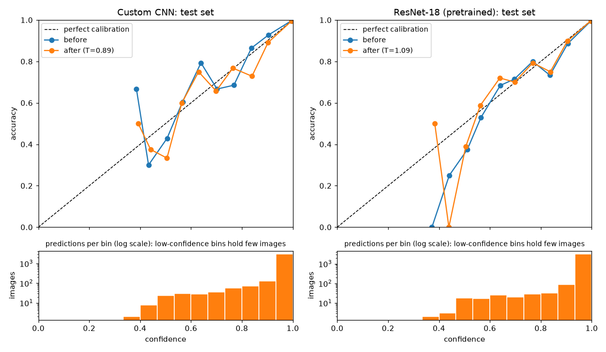

# AI Vision & Biomedical Analytics Platform

[](https://github.com/jia-jing-zhang-dev/AI-Vision-Biomedical-Analytics-Platform/actions/workflows/tests.yml)
[](https://visionserve-full-stack-ml-framework.streamlit.app/)

A machine-learning, computer-vision, and biomedical-image-analysis project with a deployed Streamlit app and reusable, tested modules for classification, clustering, image segmentation, convolution, visualization, and deep learning.

**Live demo:** <https://visionserve-full-stack-ml-framework.streamlit.app/>

| Result | Value |
|---|---|
| BloodMNIST blood-cell classification (custom CNN, 8 classes) | **96.7%** test accuracy (fully connected baseline: 72.9%) |
| BloodMNIST, ImageNet-pretrained ResNet-18 reference | 97.9% test accuracy, with a 20× larger model |
| Touching-cell segmentation, instance F1 (50 images) | **0.80** watershed vs. 0.60 Otsu; Cellpose reference 0.90 |
| FashionMNIST clothing classification (MLP, 10 classes) | 86.9% test accuracy |
| **Real nuclei segmentation** (BBBC039 test set, expert annotations) | U-Net trained here: F1 **0.951** at IoU 0.5, on par with pretrained Cellpose (0.938; not a significant difference). Average F1 over IoU 0.50–0.90: U-Net 0.863, Cellpose 0.902, best classical 0.830 |
| Confidence calibration | Both blood-cell models already well calibrated (test ECE 0.9% and 0.5%); temperature scaling makes no significant difference |

## Features

- **Blood-cell classification** — a PyTorch CNN that classifies 8 blood-cell types from BloodMNIST at **96.7% test accuracy** (vs. 72.9% for a fully connected baseline), with hyperparameters tuned by Optuna on the validation split. Compared against torchvision's ImageNet-pretrained **ResNet-18** and the published MedMNIST v2 benchmarks.
- **Real-data segmentation benchmark** — every method evaluated on BBBC039, 200 fluorescence images of U2OS nuclei with expert annotations and an official train/validation/test split, using the metrics of the dataset's reference paper.
- **U-Net for nucleus segmentation** — a 1.9 M-parameter U-Net trained here on BBBC039 with the three-class (background / interior / boundary) formulation of Caicedo et al. (2019); available in the app's segmentation page.
- **Explainability (Grad-CAM)** — heatmaps of where each blood-cell model looked, verified against the `pytorch-grad-cam` library (correlation > 0.999).
- **Confidence calibration** — temperature scaling fitted on the validation split, with reliability diagrams and ECE on the test split; both models were already well calibrated (test ECE < 1%), so scaling changes their confidences only marginally.
- **FashionMNIST clothing classification** — a PyTorch three-layer fully connected network that predicts one of ten clothing classes from an uploaded image (86.9% test accuracy).
- **Biomedical image segmentation** — six classical methods: Otsu thresholding, adaptive thresholding, K-Means, Canny edge filling, top-hat background correction, and a distance-transform watershed that splits touching cells — benchmarked against **Cellpose**, the standard deep-learning tool for cell segmentation. Brightfield images (dark cells on a light background, such as stained blood smears) are detected and inverted automatically.
- **Segmentation benchmark** — generates realistic synthetic microscopy images (touching nuclei, uneven illumination, blur, noise) with per-cell ground truth, and scores every method with pixel-level Dice / IoU and object-level instance F1.
- **Machine-learning utilities** — decision trees, random forests, ANOVA feature selection, Optuna tuning, and K-Means clustering analysis.
- **Image-processing fundamentals** — a NumPy implementation of 2D convolution with edge-detection, sharpening, Sobel, and box-blur kernels.
- **Visualization utilities** — EDA plotting helpers built with Matplotlib and Seaborn.

## Project Structure

```text
.
├── app.py                          # Streamlit home page
├── pages/
│   ├── 1_Deep_Learning.py           # FashionMNIST classification page
│   ├── 2_Biomedical_Segmentation.py # Biomedical segmentation page
│   └── 3_Blood_Cell_Classifier.py   # BloodMNIST classification page
├── src/
│   ├── vision_cnn.py                # PyTorch model and training helpers
│   ├── medical_cnn.py               # BloodMNIST CNN, training and inference helpers
│   ├── segmentation.py              # Classical segmentation, Dice / IoU / instance-F1 benchmark
│   ├── classification.py            # Supervised learning and Optuna tuning
│   ├── clustering.py                # K-Means and silhouette-based model selection
│   ├── convolution.py               # NumPy 2D convolution
│   ├── image_io.py                  # Upload loading: 16-bit, transparency, EXIF, size limits
│   ├── bbbc039.py                   # BBBC039 loader (mask decoding, percentile normalization)
│   ├── unet.py                      # U-Net, 3-class encoding/decoding for touching nuclei
│   ├── explain.py                   # Grad-CAM for the blood-cell models
│   ├── calibration.py               # Temperature scaling, ECE, reliability curves
│   ├── runtime.py                   # App resource settings: heavy-work lock, torch threads
│   └── visualization.py             # EDA visualization helpers
├── notebooks/demo_end_to_end.ipynb  # Walkthrough of the classical-ML, clustering, segmentation and convolution modules
├── public/                          # Figures, BloodMNIST and FashionMNIST sample images
├── train.py                         # FashionMNIST training script
├── train_medical.py                 # BloodMNIST training / tuning script
├── benchmark_segmentation.py        # Segmentation benchmark over many images
├── benchmark_bbbc039.py             # Real-data segmentation benchmark (BBBC039)
├── train_unet.py                    # Train the nucleus U-Net on BBBC039
├── calibrate_medical.py             # Temperature-scale the blood-cell models
├── unet_bbbc039.pth                 # Trained U-Net weights (7.8 MB) + *_results.json
├── bbbc039_results.json             # BBBC039 test-set results of every method
├── biomedical_*_calibration.json    # Fitted temperatures and before/after test metrics
├── fashion_model.pth                # Trained FashionMNIST weights
├── biomedical_cnn.pth               # Trained BloodMNIST CNN weights
├── biomedical_cnn_results.json      # Hyperparameters and val/test accuracy
├── biomedical_resnet18.pth          # Fine-tuned ResNet-18 weights (reference model)
├── biomedical_resnet18_results.json # Its hyperparameters and val/test accuracy
├── requirements.txt                 # App dependencies (what Streamlit Cloud installs)
├── requirements-ml.txt              # scikit-learn, seaborn, Optuna
├── requirements-dev.txt             # ml + Cellpose, MedMNIST, pytest
├── .streamlit/config.toml           # Upload size cap, error-detail level
├── Dockerfile                       # Container for the Streamlit app (CPU-only PyTorch)
├── pyproject.toml                   # pytest configuration
├── CLAUDE.md                        # Contributor notes, review checklist and log
├── .github/workflows/tests.yml      # CI: Python 3.12 (full) and 3.14 (as deployed)
└── tests/                           # pytest suite (run in CI on every push)
```

## Requirements

- Python 3.10 or later for the app (3.10–3.12 if you also want the Cellpose benchmark)
- A virtual environment is recommended

```bash
git clone https://github.com/jia-jing-zhang-dev/AI-Vision-Biomedical-Analytics-Platform.git
cd AI-Vision-Biomedical-Analytics-Platform
python -m venv .venv
```

Activate it:

```bash
source .venv/bin/activate        # Linux / macOS
.venv\Scripts\activate.bat       # Windows cmd
.\.venv\Scripts\Activate.ps1     # Windows PowerShell (may need: Set-ExecutionPolicy -Scope CurrentUser RemoteSigned)
```

The dependencies are split into three files:

| File | Contents | Used by |
|---|---|---|
| `requirements.txt` | App dependencies, with CPU-only PyTorch | Streamlit Cloud, Docker |
| `requirements-ml.txt` | scikit-learn, seaborn, Optuna (classical ML, tuning) | Training, notebook, tests |
| `requirements-dev.txt` | `requirements-ml.txt` + Cellpose, MedMNIST, pytest | Training, benchmarks, tests |

```bash
pip install -r requirements.txt                                 # run the app
pip install -r requirements.txt -r requirements-ml.txt pytest   # app + tests (any Python version, no Cellpose)
pip install -r requirements.txt -r requirements-dev.txt         # everything (Python 3.10-3.12)
pip install notebook                                            # optional: to open the notebook
```

> Cellpose 3 requires `numpy<2.1`, which has no prebuilt wheels for Python 3.14, so use Python 3.10–3.12 for the extras. The deployed app does not install Cellpose and hides it automatically; its benchmark results are reported below.

> `requirements.txt` installs CPU-only PyTorch: it points `--find-links` at the PyTorch CPU wheels (deliberately not an extra package index, which would also serve outdated versions of other packages). To train on a GPU, first install the CUDA build of the torch/torchvision versions pinned in `requirements.txt`, using the command from the [official PyTorch installation page](https://pytorch.org/get-started/locally/).

## Run the Web Application

From the project root, run:

```bash
streamlit run app.py
```

Open the local URL displayed in the terminal, then use the sidebar to switch between modules:

1. **Deep Learning** — upload a JPG, JPEG, or PNG clothing image and run FashionMNIST classification.
2. **Biomedical Segmentation** — either generate a synthetic benchmark image (realistic cells or simple shapes) to compare masks, Dice / IoU and instance F1, run a 10-image benchmark, or upload a grayscale or color medical image to view segmentation results from every algorithm.
3. **Blood Cell Classifier** — pick a bundled BloodMNIST test image (one per class) or upload your own, and see both models' predictions (custom CNN and ResNet-18) and class probabilities.

Uploads (JPG/PNG, including 16-bit and transparent PNGs and rotated phone photos) are accepted up to 25 megapixels and downscaled to at most 1024 px before processing, which keeps the app within Streamlit Cloud's memory limit.

### Run with Docker

```bash
docker build -t vision-analytics .
docker run -p 8501:8501 vision-analytics
```

Then open <http://localhost:8501>.

## Train Models

### FashionMNIST Clothing Classifier

```bash
python train.py
```

The script downloads FashionMNIST to `data/`, trains for five epochs with a fixed seed (the shipped model reaches 86.9% test accuracy), and saves the weights as `fashion_model.pth`. The classification page loads this file; if it is removed or replaced, train the model again before starting the page.

### BloodMNIST Biomedical Classifier

```bash
python train_medical.py --optuna 20   # reproduces the shipped model (96.7%)
```

The script downloads BloodMNIST from MedMNIST, runs a 20-trial Optuna search on the validation split, trains the chosen CNN for 15 epochs, keeps the epoch with the best **validation** accuracy, evaluates the held-out **test** split once, and writes `biomedical_cnn.pth`, `biomedical_cnn_results.json` and `public/bloodmnist-confusion.png`. The Blood Cell Classifier page loads these files.

> Without `--optuna`, the default hyperparameters are used (96.0%) and the shipped weights, results and figure are **overwritten**; the old calibration file is removed (re-run `calibrate_medical.py`). Pass `--out runs/model.pth` (create `runs/` first) to write an experiment elsewhere; its results and figure then go next to it.

```bash
python train_medical.py --model mlp   # reproduce the original fully connected baseline
python train_medical.py --model resnet18   # fine-tune ImageNet-pretrained ResNet-18 (224×224 input, 10 epochs by default)
```

#### Results (BloodMNIST test split, 3,421 images)

| Model | Test accuracy |
|---|---|
| Fully connected baseline (flattened pixels → 128 → 8, 5 epochs) | 72.9% |
| CNN, default hyperparameters (seeds 0, 1, 2) | 96.0% / 96.4% / 96.4% |
| **CNN, Optuna-tuned (20 trials, seed 0) — shipped model** | **96.7%** |
| ResNet-18, ImageNet-pretrained, fine-tuned at 224×224 (torchvision) | 97.9% |
| *Published (MedMNIST v2, Table 3):* ResNet-18 (28) / ResNet-18 (224) / Google AutoML Vision | *95.8% / 96.3% / 96.6%* |

The jump from 72.9% comes with switching to a CNN trained longer (15 instead of 5 epochs, AdamW with a cosine schedule) with augmentation (random flips and 90° rotations); no ablation separates architecture, augmentation and training length. Optuna tuning adds 0.3–0.7 points over the three default runs. On the same test images the tuned model beats the seed-0 default (paired McNemar test, 47 vs. 25 images only one model gets right, p = 0.01), but the tuned configuration was trained with a single seed and the default varies by 0.4 points between seeds, so the tuning gain is small and not firmly established. The 1.3-point gain of ResNet-18 over the custom CNN is significant (McNemar, 63 vs. 20, p < 0.001).

Training is deterministic (`set_deterministic` fixes every seed and forces deterministic GPU kernels), so each command reproduces its number exactly on the same hardware; other GPUs or library versions can differ by a few tenths of a point.

**Custom CNN vs. a mature pretrained model:** the custom CNN (2.2 MB, 0.56 M parameters) is on par with the best published BloodMNIST results in the MedMNIST v2 paper. Fine-tuning ImageNet-pretrained ResNet-18 (44.8 MB, 11.2 M parameters, 20× larger) gains another 1.3 points (97.92% vs. 96.67%) — transfer learning helps, at a large cost in model size. The published baselines were trained under the paper's own protocol (not with this project's augmentation, tuning or ImageNet pretraining), so treat that comparison as indicative rather than like-for-like. The app shows both models' predictions side by side.


The hardest classes are monocytes (91.5% recall, most often mistaken for immature granulocytes) and immature granulocytes (92.2% recall, most often mistaken for monocytes).

*Data: [MedMNIST v2](https://medmnist.com/) BloodMNIST, CC BY 4.0 (Yang et al., Scientific Data 2023). Educational project — not for clinical use.*

## Segmentation Benchmark

```bash
python benchmark_segmentation.py --images 50   # also refreshes public/cell-segmentation-benchmark.png when Cellpose is installed
```

Without Cellpose the shipped figure is left untouched (it has a Cellpose panel); use `--figure path.png` to save an example elsewhere.

Results on 50 synthetic cell images (~45 nuclei each, mean ± std):

| Method | Dice | IoU | Instance F1 |
|---|---|---|---|
| *Cellpose 3, pretrained `nuclei` model (deep-learning reference)* | *0.979 ± 0.013* | *0.960 ± 0.023* | *0.895 ± 0.049* |
| **Top-hat + watershed** | **0.935 ± 0.017** | **0.879 ± 0.030** | **0.798 ± 0.060** |
| Top-hat + Otsu | 0.935 ± 0.017 | 0.879 ± 0.030 | 0.609 ± 0.082 |
| Otsu | 0.932 ± 0.018 | 0.873 ± 0.032 | 0.598 ± 0.084 |
| K-Means (K=2) | 0.932 ± 0.018 | 0.873 ± 0.031 | 0.598 ± 0.084 |
| Adaptive threshold | 0.774 ± 0.027 | 0.632 ± 0.035 | 0.521 ± 0.079 |
| Canny + hole filling | 0.823 ± 0.014 | 0.700 ± 0.021 | 0.389 ± 0.075 |


On a real brightfield blood smear, the light background is detected and the image inverted before segmentation:


**What this shows:** pixel-level Dice cannot tell the thresholding methods apart — they all find the foreground well. Instance F1 can: thresholding merges touching nuclei into one object, while the watershed, seeded at peaks of the distance transform, separates them (+0.20 instance F1). Top-hat illumination correction helps only slightly here, because Otsu is already fairly robust to this level of shading. Cellpose, a pretrained deep-learning model (run with automatic diameter estimation, so nothing is tuned to these images), is the strongest method — about 0.10 instance F1 above the watershed — and shows how far classical methods are from the state of the art. Instance F1 counts a predicted object as correct when it overlaps a true cell with IoU > 0.5; objects under 20 pixels are ignored in both the prediction and the ground truth.

Method parameters were chosen while looking at images 0–9. On 50 unseen images (seeds 100–149) the result holds: Cellpose 0.904, watershed 0.819, Otsu 0.620 instance F1.

The original three-shape image is still available as an "easy" sanity check, where Otsu, K-Means, top-hat and watershed all reach Dice 1.0.

## Real-Data Segmentation Benchmark (BBBC039)

[BBBC039](https://bbbc.broadinstitute.org/BBBC039) contains 200 fluorescence images (520×696, 12-bit) of U2OS cell nuclei with expert annotations of every nucleus (~23,000 in total) and an official split of 100 training / 50 validation / 50 test images. Download `images.zip`, `masks.zip` and `metadata.zip` from the dataset page and unzip them into `data/bbbc039/`.

```bash
python train_unet.py --data-dir data/bbbc039                                     # ~5 min on a laptop GPU
python benchmark_bbbc039.py --data-dir data/bbbc039 --unet unet_bbbc039.pth       # evaluates the 50 test images
```

Images are converted to 8-bit with percentile normalization (0.5–99.8%). Metrics follow the dataset's reference paper (Caicedo et al., *Cytometry A* 2019): per-image instance F1 at IoU > 0.5 and **average F1** over IoU thresholds 0.50–0.90 (step 0.05), which also rewards accurate outlines, averaged over the 50 test images. One difference: the main columns ignore objects under 20 pixels on both sides (156 of the 5,720 annotated test nuclei, mostly micronuclei and fragments), whereas the paper keeps every annotated nucleus. The last column uses the paper's protocol (all annotations kept, predictions still filtered); compare the paper's row with that column.

| Method (BBBC039 test set, 50 images) | Dice | Instance F1 @ IoU 0.5 | Average F1, IoU 0.50–0.90 | Average F1, paper protocol |
|---|---|---|---|---|
| **U-Net (trained here)** | 0.951 ± 0.009 | 0.951 ± 0.077 | 0.863 ± 0.100 | 0.850 |
| Cellpose 3 (pretrained) | 0.948 ± 0.124 | 0.938 ± 0.148 | 0.902 ± 0.156 | 0.889 |
| Adaptive threshold | 0.957 ± 0.009 | 0.898 ± 0.087 | 0.830 ± 0.101 | 0.819 |
| Top-hat + watershed | 0.947 ± 0.014 | 0.900 ± 0.090 | 0.805 ± 0.103 | 0.794 |
| Otsu | 0.950 ± 0.013 | 0.829 ± 0.107 | 0.744 ± 0.107 | 0.733 |
| Top-hat + Otsu | 0.946 ± 0.014 | 0.826 ± 0.108 | 0.734 ± 0.107 | 0.723 |
| Canny + hole filling | 0.868 ± 0.017 | 0.663 ± 0.130 | 0.431 ± 0.099 | 0.425 |
| *Reference paper: U-Net / DeepCell / CellProfiler (advanced)* | | | | *0.898 / 0.858 / 0.811* |



**What this shows:**
- The U-Net trained here is on par with Cellpose at IoU 0.5 (0.951 vs. 0.938 on average). Cellpose scores higher on 35 of the 50 images (U-Net higher on 12, 3 ties); the U-Net's higher mean comes from one sparse image, `IXMtest_F12_s8`, where Cellpose returns a single object for 7 nuclei (F1 0.0). Without that image Cellpose leads by 0.008 at IoU 0.5 and by 0.058 in average F1. Under the paper's protocol the U-Net (0.850) beats the paper's CellProfiler baseline (0.811) on average F1, but its outlines are less precise than Cellpose's or the paper's own U-Net (0.889 and 0.898). It is a small model (1.9 M parameters, 60 short epochs) without the paper's training budget.
- Real data reorders the classical methods: the adaptive threshold, weak on the synthetic benchmark, is the best classical method on real nuclei by average F1 and Dice (0.830 / 0.957) and ties with the watershed at IoU 0.5 (0.898 vs. 0.900), while Canny edges fail on the soft nucleus borders. These classical scores depend on the 20-pixel filter on predictions: without it the adaptive threshold's average F1 falls to about 0.66.
- The classical methods use the parameters developed on the synthetic benchmark, without tuning on BBBC039.
- The large standard deviations come mostly from one hard test image (`IXMtest_A12_s7`) on which every method struggles (F1: U-Net 0.45, adaptive 0.35, watershed 0.32); without it the U-Net's F1 standard deviation is 0.028 instead of 0.077. Cellpose's large standard deviation comes from `IXMtest_F12_s8` (above).

**Protocol note.** The U-Net checkpoint was selected on the validation split. Its first test-set evaluation exposed a decoding error: the boundary class extends one pixel outside each nucleus (as in the paper), but decoding grew nuclei over that pixel, so every nucleus came out one pixel too large (test average F1 0.622). The fix (erode the predicted foreground by one pixel) follows from the label definition; it was compared with the old decoding on the **validation** split only (average F1 0.635 → 0.854), and the test set was then evaluated once more. A unit test now checks that encoding and decoding reproduce nucleus outlines. A later code review found that the same erosion also trimmed nuclei cut by the image border; fixing it raised validation average F1 from 0.854 to 0.873, and the test set was evaluated a third time with that fix (0.845 → 0.863). That second fix was validated on the validation split, but the search for it was not blind to the earlier test results. The weights never changed; only the decoding did. Large uploads are processed in 384-pixel tiles, which keeps memory bounded without changing results on BBBC039-sized images.

## Explainability and Calibration (blood-cell models)

**Grad-CAM.** The Blood Cell Classifier page can show a Grad-CAM heatmap for each model: the image regions that pushed it towards its prediction. The implementation (`src/explain.py`) splits the forward pass by hand instead of registering hooks, because the app shares one cached model between all visitors. A test checks that its heatmaps match the [`pytorch-grad-cam`](https://github.com/jacobgil/pytorch-grad-cam) library (correlation > 0.999).

**Calibration.** A model is well calibrated when, among predictions made with 90% confidence, about 90% are right. `calibrate_medical.py` fits a single temperature per model on the validation split (temperature scaling, Guo et al. 2017) and measures the expected calibration error (ECE, 15 bins, via `torchmetrics`) on the test split:

| Model | Temperature | Test ECE before → after | Test accuracy |
|---|---|---|---|
| Custom CNN | 0.89 | 0.89% → 0.65% | 96.67% (unchanged) |
| ResNet-18 | 1.09 | 0.50% → 0.36% | 97.92% (unchanged) |

Both models were already well calibrated (ECE below 1%). Temperature scaling changes very little, and the change is not statistically significant: a paired bootstrap over the test images (1,000 resamples) gives a 95% interval for the ECE change of -0.60 to +0.38 points for the CNN and -0.30 to +0.22 points for ResNet-18, both including zero. The fitted temperatures are applied in the app, but they are close to 1, so the confidences barely change.



## Run Tests

From the repository root, after installing at least `requirements.txt`, `requirements-ml.txt` and pytest:

```bash
pytest tests/
```

Tests that need Cellpose or MedMNIST are skipped when those packages are absent.

The tests cover classification, clustering, segmentation metrics, 2D convolution (checked against SciPy), and the BloodMNIST CNN. `tests/test_app.py` drives every page of the Streamlit app headlessly with Streamlit's `AppTest`: each button, selector and seed input, plus uploads of brightfield, fluorescence, oversized and blood-cell images.

## Troubleshooting

### `fashion_model.pth` cannot be found

Run `python train.py` from the project root, or confirm that the trained weight file is still located there.

### Dataset download fails during training

Both `train.py` and `train_medical.py` download their datasets on the first run. Check your internet connection and try again.

### Uploaded clothing images produce weak predictions

The model is trained on 28×28 grayscale FashionMNIST images. For better results, use a clear, centered image of a single clothing item. The application prepares uploads the way FashionMNIST itself was made: it converts them to grayscale, inverts them when the background is light (FashionMNIST items are light on black), removes the background, crops and centres the item and scales its longer side to fill 28 pixels. The page shows this 28×28 input and the top-3 probabilities. On 2,000 test images turned into product-photo-like uploads (small, off-centre, on an off-white background) this raises accuracy from 12% (squeezing the whole photo to 28×28) to 86%; real photos with shadows or textured backgrounds remain harder.

## Data and Credits

- **BloodMNIST** — Yang et al., *MedMNIST v2*, Scientific Data 2023, built from Acevedo et al., *A dataset of microscopic peripheral blood cell images for development of automatic recognition systems*, Data in Brief 2020; [CC BY 4.0](https://creativecommons.org/licenses/by/4.0/). `public/blood_samples/` holds one test image per class, upscaled from 28×28 to 112×112 (nearest neighbour) for display.
- **FashionMNIST** — Xiao, Rasul & Vollgraf (Zalando Research), arXiv:1708.07747, 2017, MIT License. `public/fashion_samples/` holds one unmodified 28×28 test image per class.
- **ResNet-18** — initialized from torchvision's ImageNet-pretrained weights before fine-tuning.
- **Cellpose** — Stringer et al., *Cellpose: a generalist algorithm for cellular segmentation*, Nature Methods 2021 (the `nuclei` model); the installed version is Cellpose 3 (Stringer & Pachitariu, Nature Methods 2025).
- **U-Net** — Ronneberger, Fischer & Brox, *U-Net: Convolutional Networks for Biomedical Image Segmentation*, MICCAI 2015.
- **BBBC039** — Caicedo et al., *Evaluation of Deep Learning Strategies for Nucleus Segmentation in Fluorescence Images*, Cytometry A 2019; available from the Broad Bioimage Benchmark Collection (Ljosa et al., Nature Methods 2012), CC0. The three-class U-Net formulation and the average-F1 metric follow this paper.
- **Grad-CAM** — Selvaraju et al., ICCV 2017. **Temperature scaling** — Guo et al., *On Calibration of Modern Neural Networks*, ICML 2017 (fitting procedure after github.com/gpleiss/temperature_scaling).
