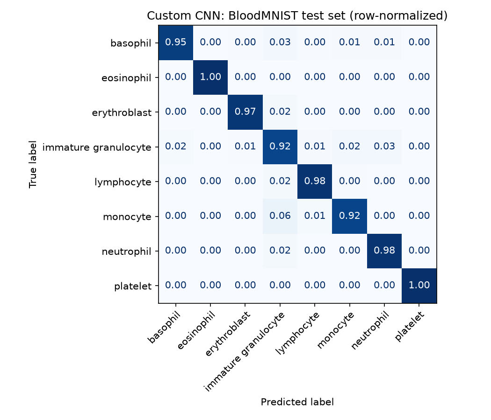
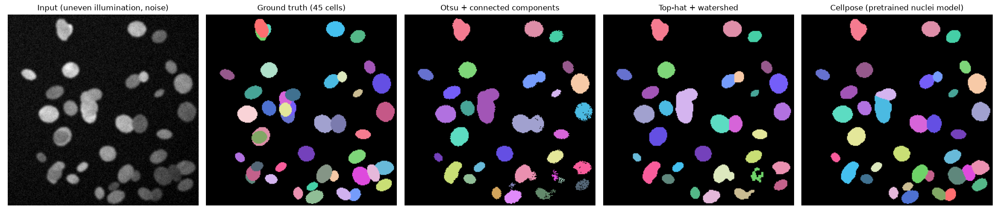
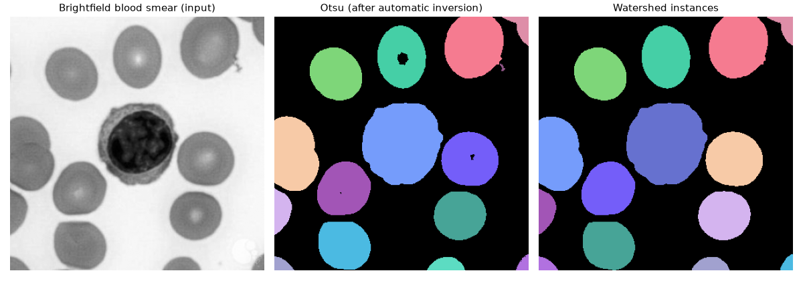

# AI Vision & Biomedical Analytics Platform

[](https://github.com/jia-jing-zhang-dev/AI-Vision-Biomedical-Analytics-Platform/actions/workflows/tests.yml)
[](https://visionserve-full-stack-ml-framework.streamlit.app/)

A machine-learning, computer-vision, and biomedical-image-analysis project with a deployed Streamlit app and reusable, tested modules for classification, clustering, image segmentation, convolution, visualization, and deep learning.

**Live demo:** <https://visionserve-full-stack-ml-framework.streamlit.app/>

| Result | Value |
|---|---|
| BloodMNIST blood-cell classification (custom CNN, 8 classes) | **96.7%** test accuracy (fully connected baseline: 72.9%) |
| BloodMNIST, ImageNet-pretrained ResNet-18 reference | 97.9% test accuracy, with a 20× larger model |
| Touching-cell segmentation, instance F1 (50 images) | **0.80** watershed vs. 0.60 Otsu; Cellpose reference 0.90 |
| FashionMNIST clothing classification (MLP, 10 classes) | 86.9% test accuracy |

## Features

- **Blood-cell classification** — a PyTorch CNN that classifies 8 blood-cell types from BloodMNIST at **96.7% test accuracy** (vs. 72.9% for a fully connected baseline), with hyperparameters tuned by Optuna on the validation split. Compared against torchvision's ImageNet-pretrained **ResNet-18** and the published MedMNIST v2 benchmarks.
- **FashionMNIST clothing classification** — a PyTorch three-layer fully connected network that predicts one of ten clothing classes from an uploaded image (86.9% test accuracy).
- **Biomedical image segmentation** — six classical methods: Otsu thresholding, adaptive thresholding, K-Means, Canny edge filling, top-hat background correction, and a distance-transform watershed that splits touching cells — benchmarked against **Cellpose**, the standard deep-learning tool for cell segmentation. Brightfield images (dark cells on a light background, such as stained blood smears) are detected and inverted automatically.
- **Segmentation benchmark** — generates realistic synthetic microscopy images (touching nuclei, uneven illumination, blur, noise) with per-cell ground truth, and scores every method with pixel-level Dice / IoU and object-level instance F1.
- **Machine-learning utilities** — decision trees, random forests, ANOVA feature selection, Optuna tuning, and K-Means clustering analysis.
- **Image-processing fundamentals** — a NumPy implementation of 2D convolution with edge-detection, sharpening, Sobel, and box-blur kernels.
- **Visualization utilities** — EDA plotting helpers built with Matplotlib and Seaborn.

## Project Structure

```text
.
├── app.py                          # Streamlit home page
├── pages/
│   ├── 1_Deep_Learning.py           # FashionMNIST classification page
│   ├── 2_Biomedical_Segmentation.py # Biomedical segmentation page
│   └── 3_Blood_Cell_Classifier.py   # BloodMNIST classification page
├── src/
│   ├── vision_cnn.py                # PyTorch model and training helpers
│   ├── medical_cnn.py               # BloodMNIST CNN, training and inference helpers
│   ├── segmentation.py              # Classical segmentation, Dice / IoU / instance-F1 benchmark
│   ├── classification.py            # Supervised learning and Optuna tuning
│   ├── clustering.py                # K-Means and silhouette-based model selection
│   ├── convolution.py               # NumPy 2D convolution
│   ├── image_io.py                  # Upload loading: 16-bit, transparency, EXIF, size limits
│   └── visualization.py             # EDA visualization helpers
├── notebooks/demo_end_to_end.ipynb  # Walkthrough of the classical-ML, clustering, segmentation and convolution modules
├── public/                          # Figures, BloodMNIST and FashionMNIST sample images
├── train.py                         # FashionMNIST training script
├── train_medical.py                 # BloodMNIST training / tuning script
├── benchmark_segmentation.py        # Segmentation benchmark over many images
├── fashion_model.pth                # Trained FashionMNIST weights
├── biomedical_cnn.pth               # Trained BloodMNIST CNN weights
├── biomedical_cnn_results.json      # Hyperparameters and val/test accuracy
├── biomedical_resnet18.pth          # Fine-tuned ResNet-18 weights (reference model)
├── biomedical_resnet18_results.json # Its hyperparameters and val/test accuracy
├── requirements.txt                 # App dependencies (what Streamlit Cloud installs)
├── requirements-ml.txt              # scikit-learn, seaborn, Optuna
├── requirements-dev.txt             # ml + Cellpose, MedMNIST, pytest
├── .streamlit/config.toml           # Upload size cap, error-detail level
├── Dockerfile                       # Container for the Streamlit app (CPU-only PyTorch)
├── pyproject.toml                   # pytest configuration
├── CLAUDE.md                        # Contributor notes, review checklist and log
├── .github/workflows/tests.yml      # CI: Python 3.12 (full) and 3.14 (as deployed)
└── tests/                           # pytest suite (run in CI on every push)
```

## Requirements

- Python 3.10 or later
- A virtual environment is recommended

```bash
python -m venv .venv
```

Activate it in Windows PowerShell:

```powershell
.\.venv\Scripts\Activate.ps1
```

The dependencies are split into three files:

| File | Contents | Used by |
|---|---|---|
| `requirements.txt` | App dependencies, with CPU-only PyTorch | Streamlit Cloud, Docker |
| `requirements-ml.txt` | scikit-learn, seaborn, Optuna (classical ML, tuning) | Training, notebook, tests |
| `requirements-dev.txt` | `requirements-ml.txt` + Cellpose, MedMNIST, pytest | Training, benchmarks, tests |

```bash
pip install -r requirements.txt                          # run the app
pip install -r requirements.txt -r requirements-dev.txt  # everything
```

> Cellpose 3 requires `numpy<2.1`, which has no prebuilt wheels for Python 3.14, so use Python 3.10–3.12 for the extras. The deployed app does not install Cellpose and hides it automatically; its benchmark results are reported below.

> `requirements.txt` installs CPU-only PyTorch: it points `--find-links` at the PyTorch CPU wheels (deliberately not an extra package index, which would also serve outdated versions of other packages). To train on a GPU, first install the CUDA build of the torch/torchvision versions pinned in `requirements.txt`, using the command from the [official PyTorch installation page](https://pytorch.org/get-started/locally/).

## Run the Web Application

From the project root, run:

```bash
streamlit run app.py
```

Open the local URL displayed in the terminal, then use the sidebar to switch between modules:

1. **Deep Learning** — upload a JPG, JPEG, or PNG clothing image and run FashionMNIST classification.
2. **Biomedical Segmentation** — either generate a synthetic benchmark image (realistic cells or simple shapes) to compare masks, Dice / IoU and instance F1, run a 10-image benchmark, or upload a grayscale or color medical image to view segmentation results from every algorithm.
3. **Blood Cell Classifier** — pick a bundled BloodMNIST test image (one per class) or upload your own, and see the CNN's prediction and class probabilities.

Uploads (JPG/PNG, including 16-bit and transparent PNGs and rotated phone photos) are accepted up to 25 megapixels and downscaled to at most 1024 px before processing, which keeps the app within Streamlit Cloud's memory limit.

### Run with Docker

```bash
docker build -t vision-analytics .
docker run -p 8501:8501 vision-analytics
```

Then open <http://localhost:8501>.

## Train Models

### FashionMNIST Clothing Classifier

```bash
python train.py
```

The script downloads FashionMNIST to `data/`, trains for five epochs with a fixed seed (the shipped model reaches 86.9% test accuracy), and saves the weights as `fashion_model.pth`. The classification page loads this file; if it is removed or replaced, train the model again before starting the page.

### BloodMNIST Biomedical Classifier

```bash
python train_medical.py --optuna 20   # reproduces the shipped model (96.7%)
```

The script downloads BloodMNIST from MedMNIST, runs a 20-trial Optuna search on the validation split, trains the chosen CNN for 15 epochs, keeps the epoch with the best **validation** accuracy, evaluates the held-out **test** split once, and writes `biomedical_cnn.pth`, `biomedical_cnn_results.json` and `public/bloodmnist-confusion.png`. The Blood Cell Classifier page loads these files.

> Without `--optuna`, the default hyperparameters are used (96.0%) and the shipped weights, results and figure are **overwritten**. Pass `--out runs/model.pth` to write an experiment elsewhere; its results and figure then go next to it.

```bash
python train_medical.py --model mlp   # reproduce the original fully connected baseline
python train_medical.py --model resnet18   # fine-tune ImageNet-pretrained ResNet-18 (224×224 input, 10 epochs by default)
```

#### Results (BloodMNIST test split, 3,421 images)

| Model | Test accuracy |
|---|---|
| Fully connected baseline (flattened pixels → 128 → 8, 5 epochs) | 72.9% |
| CNN, default hyperparameters (seeds 0, 1, 2) | 96.0% / 96.4% / 96.4% |
| **CNN, Optuna-tuned (20 trials, seed 0) — shipped model** | **96.7%** |
| ResNet-18, ImageNet-pretrained, fine-tuned at 224×224 (torchvision) | 97.9% |
| *Published (MedMNIST v2, Table 3):* ResNet-18 (28) / ResNet-18 (224) / Google AutoML Vision | *95.8% / 96.3% / 96.6%* |

Most of the gain comes from switching to a convolutional architecture with augmentation (random flips and 90° rotations). Optuna tuning adds 0.3–0.7 points over the three default runs; with 3,421 test images the 95% confidence interval of an accuracy near 96.5% is about ±0.6 points, so this gain is small and only borderline significant.

Training is deterministic (`set_deterministic` fixes every seed and forces deterministic GPU kernels), so each command reproduces its number exactly on the same hardware; other GPUs or library versions can differ by a few tenths of a point.

**Custom CNN vs. a mature pretrained model:** the custom CNN (2.2 MB, 0.56 M parameters) is on par with the best published BloodMNIST results in the MedMNIST v2 paper. Fine-tuning ImageNet-pretrained ResNet-18 (44.8 MB, 11.2 M parameters, 20× larger) gains another 1.3 points (97.92% vs. 96.67%) — transfer learning helps, at a large cost in model size. The published baselines were trained under the paper's own protocol (not with this project's augmentation, tuning or ImageNet pretraining), so treat that comparison as indicative rather than like-for-like. The app shows both models' predictions side by side.



The hardest classes are monocytes (91.5% recall, most often mistaken for immature granulocytes) and immature granulocytes (92.2% recall, most often mistaken for monocytes).

*Data: [MedMNIST v2](https://medmnist.com/) BloodMNIST, CC BY 4.0 (Yang et al., Scientific Data 2023). Educational project — not for clinical use.*

## Segmentation Benchmark

```bash
python benchmark_segmentation.py --images 50
```

Results on 50 synthetic cell images (~45 nuclei each, mean ± std):

| Method | Dice | IoU | Instance F1 |
|---|---|---|---|
| *Cellpose 3, pretrained `nuclei` model (deep-learning reference)* | *0.979 ± 0.013* | *0.960 ± 0.023* | *0.895 ± 0.049* |
| **Top-hat + watershed** | **0.935 ± 0.017** | **0.879 ± 0.030** | **0.798 ± 0.060** |
| Top-hat + Otsu | 0.935 ± 0.017 | 0.879 ± 0.030 | 0.609 ± 0.082 |
| Otsu | 0.932 ± 0.018 | 0.873 ± 0.032 | 0.598 ± 0.084 |
| K-Means (K=2) | 0.932 ± 0.018 | 0.873 ± 0.031 | 0.598 ± 0.084 |
| Adaptive threshold | 0.774 ± 0.027 | 0.632 ± 0.035 | 0.521 ± 0.079 |
| Canny + hole filling | 0.823 ± 0.014 | 0.700 ± 0.021 | 0.389 ± 0.075 |



On a real brightfield blood smear, the light background is detected and the image inverted before segmentation:



**What this shows:** pixel-level Dice cannot tell the thresholding methods apart — they all find the foreground well. Instance F1 can: thresholding merges touching nuclei into one object, while the watershed, seeded at peaks of the distance transform, separates them (+0.20 instance F1). Top-hat illumination correction helps only slightly here, because Otsu is already fairly robust to this level of shading. Cellpose, a pretrained deep-learning model (run with automatic diameter estimation, so nothing is tuned to these images), is the strongest method — about 0.10 instance F1 above the watershed — and shows how far classical methods are from the state of the art. Instance F1 counts a predicted object as correct when it overlaps a true cell with IoU > 0.5; objects under 20 pixels are ignored in both the prediction and the ground truth.

Method parameters were chosen while looking at images 0–9. On 50 unseen images (seeds 100–149) the result holds: Cellpose 0.904, watershed 0.819, Otsu 0.620 instance F1.

The original three-shape image is still available as an "easy" sanity check, where Otsu, K-Means, top-hat and watershed all reach Dice 1.0.

## Run Tests

```bash
pytest tests/
```

The tests cover classification, clustering, segmentation metrics, 2D convolution (checked against SciPy), and the BloodMNIST CNN. `tests/test_app.py` drives every page of the Streamlit app headlessly with Streamlit's `AppTest`: each button, selector and seed input, plus uploads of brightfield, fluorescence, oversized and blood-cell images.

## Troubleshooting

### `fashion_model.pth` cannot be found

Run `python train.py` from the project root, or confirm that the trained weight file is still located there.

### Dataset download fails during training

Both `train.py` and `train_medical.py` download their datasets on the first run. Check your internet connection and try again.

### Uploaded clothing images produce weak predictions

The model is trained on 28×28 grayscale FashionMNIST images. For better results, use a clear, centered image of a single clothing item. The application converts images to grayscale and 28×28, and inverts them only when the background is light (FashionMNIST items are light on black).

## Data and Credits

- **BloodMNIST** — Yang et al., *MedMNIST v2*, Scientific Data 2023, [CC BY 4.0](https://creativecommons.org/licenses/by/4.0/). `public/blood_samples/` holds one test image per class, upscaled from 28×28 to 112×112 (nearest neighbour) for display.
- **FashionMNIST** — Xiao, Rasul & Vollgraf (Zalando Research), MIT License. `public/fashion_samples/` holds one unmodified 28×28 test image per class.
- **ResNet-18** — initialized from torchvision's ImageNet-pretrained weights before fine-tuning.
- **Cellpose** — Stringer et al., *Cellpose: a generalist algorithm for cellular segmentation*, Nature Methods 2021.
